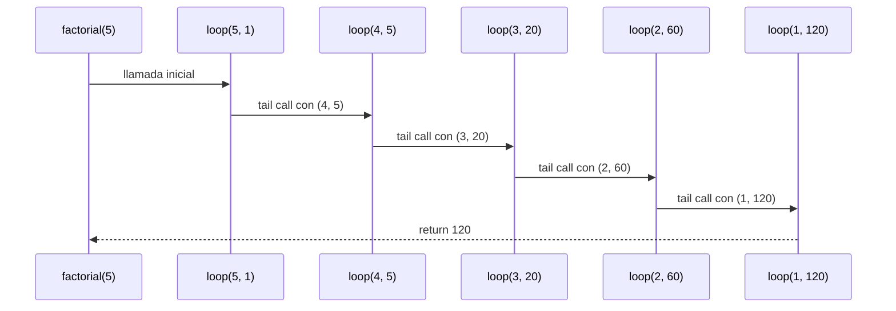
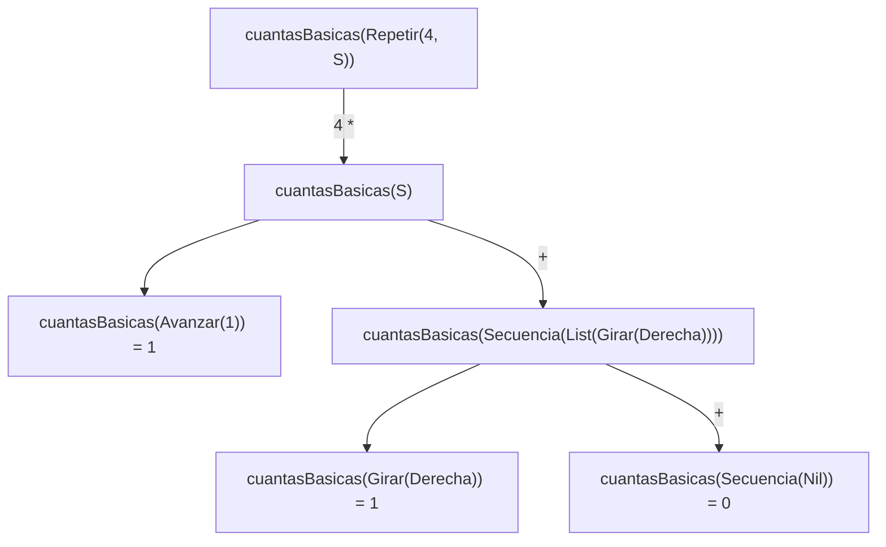
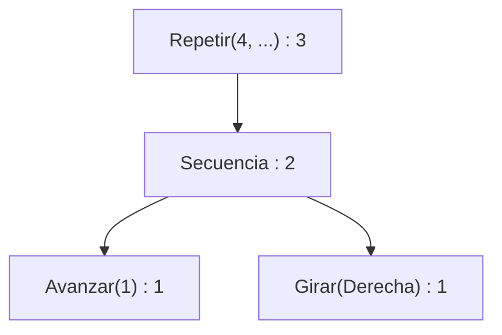
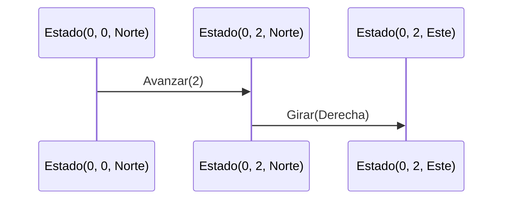

# Algoritmo Factorial con Recursión de Cola

## Definición del Algoritmo

```Scala
def factorial(n: Int): BigInt = {
  @annotation.tailrec
  def loop(x: Int, acumulador: BigInt): BigInt = {
    if (x <= 1) acumulador
    else loop(x - 1, acumulador * x)
  }
  loop(n, 1)
}
```

* La función `factorial` calcula el factorial de un número `n` utilizando **recursión de cola**.
* La función interna `loop` es la que hace la recursión:

  * Recibe dos parámetros:

    * `x`: el valor actual decreciente hasta llegar a 1.
    * `acumulador`: donde se guarda el resultado parcial en cada paso.
* El decorador `@annotation.tailrec` obliga a que la función sea optimizada como recursión de cola, es decir, **no se acumulan llamados en la pila**.

## Explicación paso a paso

### Caso base

```Scala
if (x <= 1) acumulador
```

Cuando `x` llega a `1`, la función retorna directamente el valor acumulado, evitando más llamadas.

### Caso recursivo

```Scala
loop(x - 1, acumulador * x)
```

En cada llamada:

* Se reduce el valor de `x` en 1.
* Se multiplica el acumulador por `x` y se pasa a la siguiente iteración.
* Como es recursión de cola, la llamada recursiva es la **última instrucción** en ejecutarse, lo que permite a Scala optimizar la pila.

---

## Llamados de pila en recursión de cola

Ejemplo:

```Scala
factorial(5)
```

### Paso 1: Llamada inicial

```Scala
loop(5, 1)
```

### Paso 2: Primera iteración

```Scala
loop(4, 5)   // acumulador = 1 * 5
```

### Paso 3: Segunda iteración

```Scala
loop(3, 20)  // acumulador = 5 * 4
```

### Paso 4: Tercera iteración

```Scala
loop(2, 60)  // acumulador = 20 * 3
```

### Paso 5: Cuarta iteración

```Scala
loop(1, 120) // acumulador = 60 * 2
```

### Paso 6: Caso base

```Scala
return 120
```

---

## Diferencia con recursión normal

* En **recursión normal** cada llamada queda en la pila esperando a que termine la siguiente, lo que puede causar desbordamiento si `n` es muy grande.
* En **recursión de cola**, el compilador transforma el proceso en un **bucle optimizado**, por lo que no se guarda cada llamada en la pila y el algoritmo puede ejecutarse para valores muy grandes sin problema.

---

## Ejemplo de uso

```Scala
val resultado = factorial(5)
println(resultado)  // 120
```

El resultado de `factorial(5)` es `120`.


## Diagrama de llamados de pila con recursión de cola




<!-- Arriba va el ejemplo original (factorial con recursión de cola), sin cambios -->

---

# Informe de proceso: Taller 2, un robot en la cuadrícula

Se usa esta orden en los ejemplos:

```scala
val cuadrado = Repetir(4, Secuencia(List(Avanzar(1), Girar(Derecha))))
```

## Punto 1: `girar`

> TODO: responsable del punto 1.

## Punto 2: `ejecutar`

> TODO: responsable del punto 2. Incluir la traza de `ejecutar` sobre
> `Repetir(4, Secuencia(List(Avanzar(1), Girar(Derecha))))` desde `inicial`,
> con el estado y la orden pendiente en cada paso.

## Punto 3: `cuantasBasicas` y `profundidad`

Estas funciones miden una orden **sin ejecutarla**, así que no hay posiciones
del robot que seguir. La traza muestra cómo se expande la recursión sobre la
estructura de la orden.

### `cuantasBasicas`

```scala
def cuantasBasicas(o: Orden): Int = {
  o match {
    case Avanzar(_) => 1
    case Girar(_) => 1
    case Repetir(veces, _) if veces <= 0 => 0
    case Repetir(veces, orden) => veces * cuantasBasicas(orden)
    case Secuencia(Nil) => 0
    case Secuencia(c :: cs) => cuantasBasicas(c) + cuantasBasicas(Secuencia(cs))
  }
}
```

Cómo funciona, caso por caso:

- **Avanzar / Girar:** es una orden básica, cuenta 1.
- **Repetir con `veces <= 0`:** no se ejecuta nada, cuenta 0.
- **Repetir con `veces > 0`:** el cuerpo se ejecuta `veces` veces, así que se
  multiplica `veces` por lo que cuenta el cuerpo.
- **Secuencia vacía:** cuenta 0.
- **Secuencia `c :: cs`:** se cuenta la primera orden y se suma lo que cuente
  el resto de la secuencia.

Traza de `cuantasBasicas(cuadrado)`:

| Paso | Expresión por evaluar | Regla aplicada |
|------|-----------------------|----------------|
| 1 | `cuantasBasicas(Repetir(4, S))` | Repetir, `4 > 0` |
| 2 | `4 * cuantasBasicas(S)`, con `S = Secuencia(List(Avanzar(1), Girar(Derecha)))` | expandir |
| 3 | `4 * (cuantasBasicas(Avanzar(1)) + cuantasBasicas(Secuencia(List(Girar(Derecha)))))` | Secuencia `c :: cs` |
| 4 | `4 * (1 + cuantasBasicas(Secuencia(List(Girar(Derecha)))))` | Avanzar |
| 5 | `4 * (1 + (cuantasBasicas(Girar(Derecha)) + cuantasBasicas(Secuencia(Nil))))` | Secuencia `c :: cs` |
| 6 | `4 * (1 + (1 + 0))` | Girar y Secuencia vacía |
| 7 | `4 * 2 = 8` | aritmética |

Resultado: `cuantasBasicas(cuadrado) = 8`.



### `profundidad`

```scala
def profundidad(o: Orden): Int = {
  def mayorP(ordenes: List[Orden]): Int = {
    ordenes match {
      case Nil => 0
      case c :: cs =>
        val actual = profundidad(c)
        val resto = mayorP(cs)
        if (actual > resto) actual
        else resto
    }
  }
  o match {
    case Avanzar(_) => 1
    case Girar(_) => 1
    case Repetir(_, orden) => 1 + profundidad(orden)
    case Secuencia(Nil) => 1
    case Secuencia(ordenes) => 1 + mayorP(ordenes)
  }
}
```

Cómo funciona:

- **Avanzar / Girar:** profundidad 1.
- **Repetir:** un nivel más que la profundidad de su cuerpo.
- **Secuencia vacía:** profundidad 1, porque no contiene nada más hondo.
- **Secuencia no vacía:** 1 más la mayor profundidad entre sus elementos.
- **`mayorP`** es la función auxiliar que recorre la lista y devuelve el
  máximo de las profundidades. Para la lista vacía devuelve 0.

Traza de `profundidad(cuadrado)`:

| Paso | Expresión por evaluar | Regla aplicada |
|------|-----------------------|----------------|
| 1 | `profundidad(Repetir(4, S))` | Repetir |
| 2 | `1 + profundidad(S)` | expandir |
| 3 | `1 + (1 + mayorP(List(Avanzar(1), Girar(Derecha))))` | Secuencia no vacía |
| 4 | `mayorP(List(Avanzar(1), Girar(Derecha)))`: `actual = profundidad(Avanzar(1)) = 1` | `c :: cs` |
| 5 | `resto = mayorP(List(Girar(Derecha)))`: `actual = 1`, `resto = mayorP(Nil) = 0`, devuelve `1` | `c :: cs` y `Nil` |
| 6 | `mayorP(...) = max(1, 1) = 1` | comparación |
| 7 | `1 + (1 + 1) = 3` | aritmética |

Resultado: `profundidad(cuadrado) = 3`.



Cada nodo muestra su profundidad: la de un nodo es 1 más la mayor de sus hijos.

## Punto 4: `componer`, `rutina`, `aplicarA` y `transformar`

### `componer`

```scala
def componer(o1: Orden, o2: Orden): Orden = Secuencia(List(o1, o2))
```

`componer` no recorre nada: solo **construye** una `Secuencia` de dos
elementos, con `o1` primero y `o2` después. El orden importa, porque `o1` se
ejecuta primero.

Traza con posiciones del robot, usando
`componer(Avanzar(2), Girar(Derecha))` desde `inicial = Estado(0, 0, Norte)`:

| Paso | Orden pendiente | Estado |
|------|-----------------|--------|
| 0 | `Secuencia(List(Avanzar(2), Girar(Derecha)))` | `Estado(0, 0, Norte)` |
| 1 | `Secuencia(List(Girar(Derecha)))` | `Estado(0, 2, Norte)` |
| 2 | `Secuencia(Nil)` | `Estado(0, 2, Este)` |

El estado final es `Estado(0, 2, Este)`, el mismo que se obtiene ejecutando
`Avanzar(2)` y luego `Girar(Derecha)` por separado.



> TODO: responsable de `rutina`, `aplicarA` y `transformar`.

## Punto 5: `simplificar`

> TODO: responsable del punto 5. Incluir el recorrido de `simplificar` sobre
> una orden que necesite más de una pasada.