# Algoritmo Factorial con Recursión de Cola

## Definición del Algoritmo

```Scala
def factorial(n: Int): BigInt = {
  @annotation.tailrec
  def loop(x: Int, acumulador: BigInt): BigInt = {
    if (x <= 1) acumulador
    else loop(x - 1, acumulador * x)
  }
  loop(n, 1)
}
```

* La función `factorial` calcula el factorial de un número `n` utilizando **recursión de cola**.
* La función interna `loop` es la que hace la recursión:

  * Recibe dos parámetros:

    * `x`: el valor actual decreciente hasta llegar a 1.
    * `acumulador`: donde se guarda el resultado parcial en cada paso.
* El decorador `@annotation.tailrec` obliga a que la función sea optimizada como recursión de cola, es decir, **no se acumulan llamados en la pila**.

## Explicación paso a paso

### Caso base

```Scala
if (x <= 1) acumulador
```

Cuando `x` llega a `1`, la función retorna directamente el valor acumulado, evitando más llamadas.

### Caso recursivo

```Scala
loop(x - 1, acumulador * x)
```

En cada llamada:

* Se reduce el valor de `x` en 1.
* Se multiplica el acumulador por `x` y se pasa a la siguiente iteración.
* Como es recursión de cola, la llamada recursiva es la **última instrucción** en ejecutarse, lo que permite a Scala optimizar la pila.

---

## Llamados de pila en recursión de cola

Ejemplo:

```Scala
factorial(5)
```

### Paso 1: Llamada inicial

```Scala
loop(5, 1)
```

### Paso 2: Primera iteración

```Scala
loop(4, 5)   // acumulador = 1 * 5
```

### Paso 3: Segunda iteración

```Scala
loop(3, 20)  // acumulador = 5 * 4
```

### Paso 4: Tercera iteración

```Scala
loop(2, 60)  // acumulador = 20 * 3
```

### Paso 5: Cuarta iteración

```Scala
loop(1, 120) // acumulador = 60 * 2
```

### Paso 6: Caso base

```Scala
return 120
```

---

## Diferencia con recursión normal

* En **recursión normal** cada llamada queda en la pila esperando a que termine la siguiente, lo que puede causar desbordamiento si `n` es muy grande.
* En **recursión de cola**, el compilador transforma el proceso en un **bucle optimizado**, por lo que no se guarda cada llamada en la pila y el algoritmo puede ejecutarse para valores muy grandes sin problema.

---

## Ejemplo de uso

```Scala
val resultado = factorial(5)
println(resultado)  // 120
```

El resultado de `factorial(5)` es `120`.


## Diagrama de llamados de pila con recursión de cola

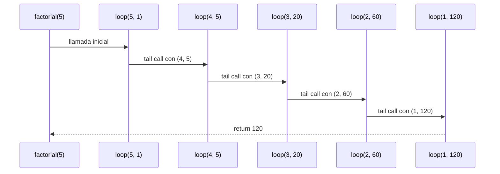


<!-- Arriba va el ejemplo original (factorial con recursión de cola), sin cambios -->

---

# Informe de proceso: Taller 2, un robot en la cuadrícula

Se usa esta orden en los ejemplos:

```scala
val cuadrado = Repetir(4, Secuencia(List(Avanzar(1), Girar(Derecha))))
```

## Punto 1: `girar`

`girar` decide hacia dónde queda mirando el robot después de girar noventa
grados. No lo mueve: la posición `(x, y)` no cambia.

```scala
def girar(d: Direccion, s: Sentido): Direccion = {
  (d, s) match {
    case (Norte, Izquierda) => Oeste
    case (Norte, Derecha) => Este
    case (Este, Izquierda) => Norte
    case (Este, Derecha) => Sur
    case (Sur, Izquierda) => Este
    case (Sur, Derecha) => Oeste
    case (Oeste, Izquierda) => Sur
    case (Oeste, Derecha) => Norte
  }
}
```

Cómo funciona:

- Los dos argumentos se agrupan en la pareja `(d, s)` y el `match` la compara
  con los casos en orden. El primero que coincide devuelve la dirección.
- Hay 8 casos, uno por cada combinación de 4 direcciones y 2 sentidos. No hay
  `if` ni cálculos: es una tabla.
- `Direccion` y `Sentido` son `sealed`, así que el compilador avisa si falta
  alguna combinación.

| Mira ahora | Giro a la izquierda | Giro a la derecha |
|------------|---------------------|-------------------|
| Norte | Oeste | Este |
| Este | Norte | Sur |
| Sur | Este | Oeste |
| Oeste | Sur | Norte |

### Traza: cuatro giros a la derecha desde `inicial`

El robot empieza en `(0, 0)` mirando al norte y gira cuatro veces a la derecha.

| Paso | Pareja evaluada | Caso que coincide | Estado `(x, y, mira)` |
|------|-----------------|-------------------|-----------------------|
| 0 | (inicio) | | `(0, 0, Norte)` |
| 1 | `(Norte, Derecha)` | `case (Norte, Derecha) => Este` | `(0, 0, Este)` |
| 2 | `(Este, Derecha)` | `case (Este, Derecha) => Sur` | `(0, 0, Sur)` |
| 3 | `(Sur, Derecha)` | `case (Sur, Derecha) => Oeste` | `(0, 0, Oeste)` |
| 4 | `(Oeste, Derecha)` | `case (Oeste, Derecha) => Norte` | `(0, 0, Norte)` |

La posición nunca cambia, y tras cuatro giros el robot vuelve a mirar al norte.

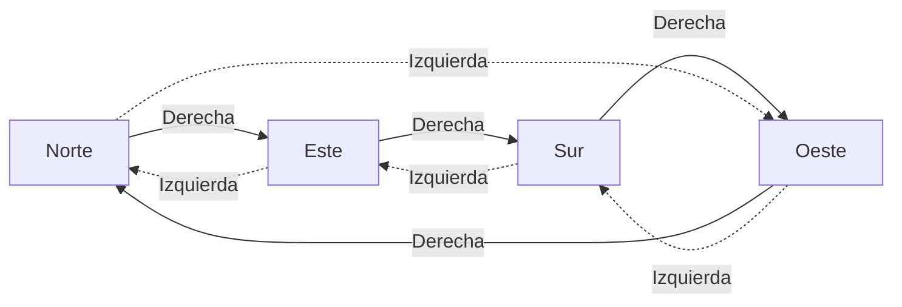

Las flechas continuas son giros a la derecha y las punteadas, a la izquierda.

## Punto 2: `ejecutar`

> `ejecutar` recibe el estado del robot (posición y dirección) y una orden, y
devuelve el estado en que queda el robot. No modifica nada: construye un
`Estado` nuevo.

```scala
def ejecutar(e: Estado, o: Orden): Estado = {
  o match {
    case Avanzar(n) =>
      e.mira match {
        case Norte => Estado(e.x, e.y + n, e.mira)
        case Sur => Estado(e.x, e.y - n, e.mira)
        case Este => Estado(e.x + n, e.y, e.mira)
        case Oeste => Estado(e.x - n, e.y, e.mira)
      }
    case Girar(sentido) => Estado(e.x, e.y, girar(e.mira, sentido))
    case Repetir(veces, _) if veces <= 0 => e
    case Repetir(veces, orden) =>
      ejecutar(ejecutar(e, orden), Repetir(veces - 1, orden))
    case Secuencia(Nil) => e
    case Secuencia(primera :: resto) =>
      ejecutar(ejecutar(e, primera), Secuencia(resto))
  }
}
```

Hay un caso por cada alternativa de `Orden`. Cómo funciona, caso por caso:

- **`Avanzar(n)`:** primero mira hacia dónde apunta el robot (`e.mira`). Al norte
  suma `n` a `y`, al sur resta `n` a `y`, al este suma `n` a `x` y al oeste
  resta `n` a `x`. Con `n` negativo el robot retrocede, sin necesitar otro caso.
- **`Girar(sentido)`:** `x` e `y` quedan igual y `mira` pasa a ser
  `girar(e.mira, sentido)`, la función del punto 1.
- **`Repetir(veces, _)` con `veces <= 0`:** no hace nada, devuelve `e`. Es la
  condición de parada. Va antes del caso general; si estuviera después, nunca se
  alcanzaría.
- **`Repetir(veces, orden)` con `veces > 0`:** ejecuta la orden una vez sobre `e`
  y sobre el estado que resulta ejecuta `Repetir(veces - 1, orden)`. En cada
  llamada `veces` baja en 1 hasta llegar a 0.
- **`Secuencia(Nil)`:** no hay nada que ejecutar, devuelve `e`.
- **`Secuencia(primera :: resto)`:** ejecuta la primera orden sobre `e` y sobre el
  estado resultante ejecuta el resto. La lista se acorta hasta llegar a `Nil`.

### Traza de `ejecutar(inicial, cuadrado)`

Sea `S = Secuencia(List(Avanzar(1), Girar(Derecha)))`, de modo que
`cuadrado = Repetir(4, S)`. La tabla muestra el estado del robot después de
ejecutar cada orden básica y qué queda por ejecutar.

| Paso | Orden que se ejecuta | Estado `(x, y, mira)` | Orden que queda por ejecutar |
|------|----------------------|-----------------------|------------------------------|
| 0 | (inicio) | `(0, 0, Norte)` | `Repetir(4, S)` |
| 1 | `Avanzar(1)` mirando al norte: `y` pasa de 0 a 1 | `(0, 1, Norte)` | `Girar(Derecha)` y luego `Repetir(3, S)` |
| 2 | `Girar(Derecha)`: Norte pasa a Este | `(0, 1, Este)` | `Repetir(3, S)` |
| 3 | `Avanzar(1)` mirando al este: `x` pasa de 0 a 1 | `(1, 1, Este)` | `Girar(Derecha)` y luego `Repetir(2, S)` |
| 4 | `Girar(Derecha)`: Este pasa a Sur | `(1, 1, Sur)` | `Repetir(2, S)` |
| 5 | `Avanzar(1)` mirando al sur: `y` pasa de 1 a 0 | `(1, 0, Sur)` | `Girar(Derecha)` y luego `Repetir(1, S)` |
| 6 | `Girar(Derecha)`: Sur pasa a Oeste | `(1, 0, Oeste)` | `Repetir(1, S)` |
| 7 | `Avanzar(1)` mirando al oeste: `x` pasa de 1 a 0 | `(0, 0, Oeste)` | `Girar(Derecha)` y luego `Repetir(0, S)` |
| 8 | `Girar(Derecha)`: Oeste pasa a Norte | `(0, 0, Norte)` | `Repetir(0, S)` |
| 9 | `Repetir(0, S)`: como `0 <= 0`, devuelve el estado | `(0, 0, Norte)` | nada |

Resultado: `ejecutar(inicial, cuadrado) = Estado(0, 0, Norte)`. El robot recorre
un cuadrado de lado 1 y vuelve al punto de partida mirando al norte.

```mermaid
graph LR
    P0["(0,0) Norte"] -->|"Avanzar(1)"| P1["(0,1) Norte"]
    P1 -->|"Girar(Derecha)"| P2["(0,1) Este"]
    P2 -->|"Avanzar(1)"| P3["(1,1) Este"]
    P3 -->|"Girar(Derecha)"| P4["(1,1) Sur"]
    P4 -->|"Avanzar(1)"| P5["(1,0) Sur"]
    P5 -->|"Girar(Derecha)"| P6["(1,0) Oeste"]
    P6 -->|"Avanzar(1)"| P7["(0,0) Oeste"]
    P7 -->|"Girar(Derecha)"| P8["(0,0) Norte"]
```

### Traza de una secuencia

`ejecutar(inicial, Secuencia(List(Avanzar(2), Girar(Derecha), Avanzar(4))))`

| Paso | Regla aplicada | Estado | Orden que queda por ejecutar |
|------|----------------|--------|------------------------------|
| 0 | (inicio) | `(0, 0, Norte)` | `Secuencia(List(Avanzar(2), Girar(Derecha), Avanzar(4)))` |
| 1 | `Secuencia(primera :: resto)`, `primera = Avanzar(2)` | `(0, 2, Norte)` | `Secuencia(List(Girar(Derecha), Avanzar(4)))` |
| 2 | `Secuencia(primera :: resto)`, `primera = Girar(Derecha)` | `(0, 2, Este)` | `Secuencia(List(Avanzar(4)))` |
| 3 | `Secuencia(primera :: resto)`, `primera = Avanzar(4)` | `(4, 2, Este)` | `Secuencia(Nil)` |
| 4 | `Secuencia(Nil)` | `(4, 2, Este)` | nada |

Resultado: `Estado(4, 2, Este)`. El último avance sumó a `x` porque el robot ya
miraba al este.

## Punto 3: `cuantasBasicas` y `profundidad`

Estas funciones miden una orden **sin ejecutarla**, así que no hay posiciones
del robot que seguir. La traza muestra cómo se expande la recursión sobre la
estructura de la orden.

### `cuantasBasicas`

```scala
def cuantasBasicas(o: Orden): Int = {
  o match {
    case Avanzar(_) => 1
    case Girar(_) => 1
    case Repetir(veces, _) if veces <= 0 => 0
    case Repetir(veces, orden) => veces * cuantasBasicas(orden)
    case Secuencia(Nil) => 0
    case Secuencia(c :: cs) => cuantasBasicas(c) + cuantasBasicas(Secuencia(cs))
  }
}
```

Cómo funciona, caso por caso:

- **Avanzar / Girar:** es una orden básica, cuenta 1.
- **Repetir con `veces <= 0`:** no se ejecuta nada, cuenta 0.
- **Repetir con `veces > 0`:** el cuerpo se ejecuta `veces` veces, así que se
  multiplica `veces` por lo que cuenta el cuerpo.
- **Secuencia vacía:** cuenta 0.
- **Secuencia `c :: cs`:** se cuenta la primera orden y se suma lo que cuente
  el resto de la secuencia.

Traza de `cuantasBasicas(cuadrado)`:

| Paso | Expresión por evaluar | Regla aplicada |
|------|-----------------------|----------------|
| 1 | `cuantasBasicas(Repetir(4, S))` | Repetir, `4 > 0` |
| 2 | `4 * cuantasBasicas(S)`, con `S = Secuencia(List(Avanzar(1), Girar(Derecha)))` | expandir |
| 3 | `4 * (cuantasBasicas(Avanzar(1)) + cuantasBasicas(Secuencia(List(Girar(Derecha)))))` | Secuencia `c :: cs` |
| 4 | `4 * (1 + cuantasBasicas(Secuencia(List(Girar(Derecha)))))` | Avanzar |
| 5 | `4 * (1 + (cuantasBasicas(Girar(Derecha)) + cuantasBasicas(Secuencia(Nil))))` | Secuencia `c :: cs` |
| 6 | `4 * (1 + (1 + 0))` | Girar y Secuencia vacía |
| 7 | `4 * 2 = 8` | aritmética |

Resultado: `cuantasBasicas(cuadrado) = 8`.

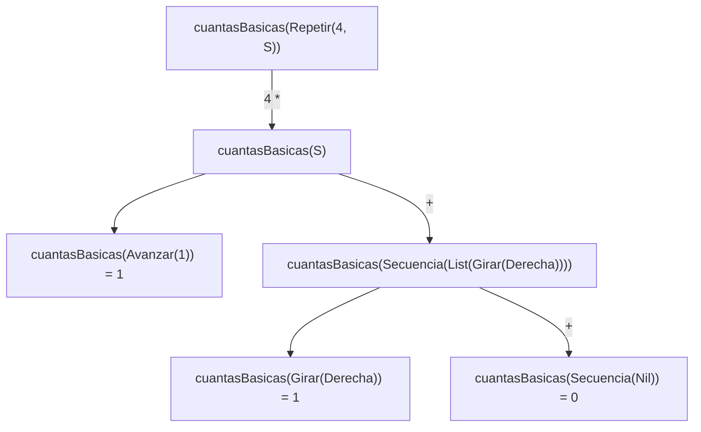

### `profundidad`

```scala
def profundidad(o: Orden): Int = {
  def mayorP(ordenes: List[Orden]): Int = {
    ordenes match {
      case Nil => 0
      case c :: cs =>
        val actual = profundidad(c)
        val resto = mayorP(cs)
        if (actual > resto) actual
        else resto
    }
  }
  o match {
    case Avanzar(_) => 1
    case Girar(_) => 1
    case Repetir(_, orden) => 1 + profundidad(orden)
    case Secuencia(Nil) => 1
    case Secuencia(ordenes) => 1 + mayorP(ordenes)
  }
}
```

Cómo funciona:

- **Avanzar / Girar:** profundidad 1.
- **Repetir:** un nivel más que la profundidad de su cuerpo.
- **Secuencia vacía:** profundidad 1, porque no contiene nada más hondo.
- **Secuencia no vacía:** 1 más la mayor profundidad entre sus elementos.
- **`mayorP`** es la función auxiliar que recorre la lista y devuelve el
  máximo de las profundidades. Para la lista vacía devuelve 0.

Traza de `profundidad(cuadrado)`:

| Paso | Expresión por evaluar | Regla aplicada |
|------|-----------------------|----------------|
| 1 | `profundidad(Repetir(4, S))` | Repetir |
| 2 | `1 + profundidad(S)` | expandir |
| 3 | `1 + (1 + mayorP(List(Avanzar(1), Girar(Derecha))))` | Secuencia no vacía |
| 4 | `mayorP(List(Avanzar(1), Girar(Derecha)))`: `actual = profundidad(Avanzar(1)) = 1` | `c :: cs` |
| 5 | `resto = mayorP(List(Girar(Derecha)))`: `actual = 1`, `resto = mayorP(Nil) = 0`, devuelve `1` | `c :: cs` y `Nil` |
| 6 | `mayorP(...) = max(1, 1) = 1` | comparación |
| 7 | `1 + (1 + 1) = 3` | aritmética |

Resultado: `profundidad(cuadrado) = 3`.

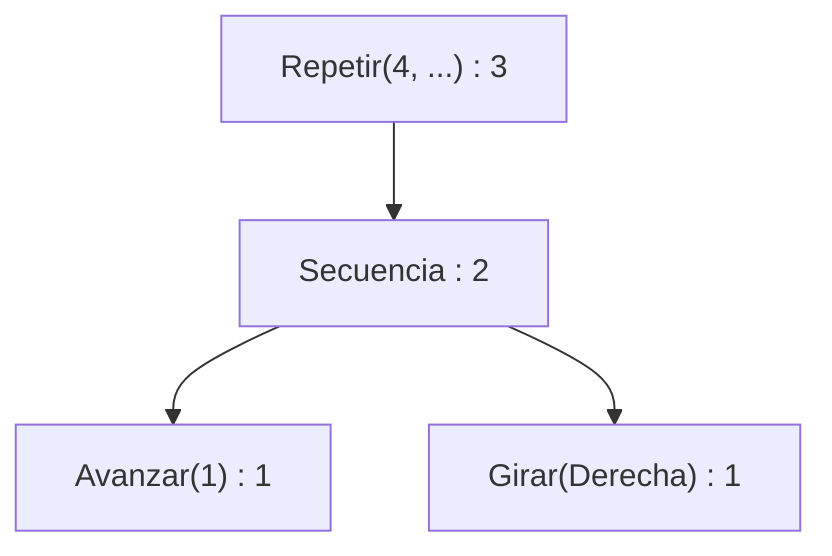

Cada nodo muestra su profundidad: la de un nodo es 1 más la mayor de sus hijos.

## Punto 4: `componer`, `rutina`, `aplicarA` y `transformar`

### `componer`

```scala
def componer(o1: Orden, o2: Orden): Orden = Secuencia(List(o1, o2))
```

`componer` no recorre nada: solo **construye** una `Secuencia` de dos
elementos, con `o1` primero y `o2` después. El orden importa, porque `o1` se
ejecuta primero.

Traza con posiciones del robot, usando
`componer(Avanzar(2), Girar(Derecha))` desde `inicial = Estado(0, 0, Norte)`:

| Paso | Orden pendiente | Estado |
|------|-----------------|--------|
| 0 | `Secuencia(List(Avanzar(2), Girar(Derecha)))` | `Estado(0, 0, Norte)` |
| 1 | `Secuencia(List(Girar(Derecha)))` | `Estado(0, 2, Norte)` |
| 2 | `Secuencia(Nil)` | `Estado(0, 2, Este)` |

El estado final es `Estado(0, 2, Este)`, el mismo que se obtiene ejecutando
`Avanzar(2)` y luego `Girar(Derecha)` por separado.

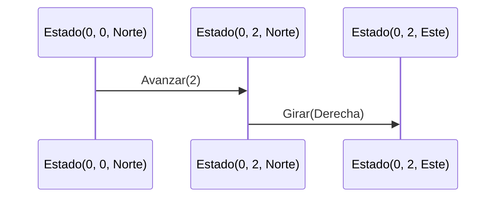

### `rutina`

```scala
def rutina(pasos: Int)(giro: Sentido)(veces: Int): Orden =
  Repetir(veces, Secuencia(List(Avanzar(pasos), Girar(giro))))
```

`rutina` tampoco recorre nada: solo construye una orden. Lo que la hace particular es que está currificada, o sea que recibe sus argumentos en tres grupos y cada grupo que se le da produce una función que espera los que faltan:

* `rutina(1)` ya fijó los pasos y es una función que espera el giro y las veces.
* `rutina(1)(Derecha)` fijó también el giro y es una función de `Int` en `Orden`: espera solo las veces.
* `rutina(1)(Derecha)(2)` ya tiene todo y devuelve la orden `Repetir(2, Secuencia(List(Avanzar(1), Girar(Derecha))))`.

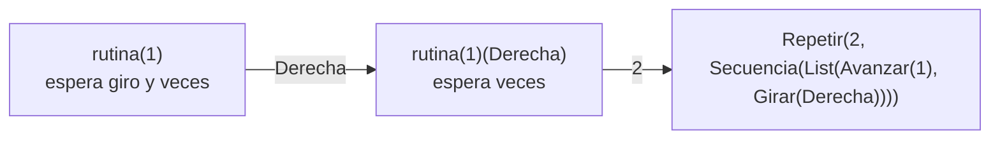

Una nota práctica: el enunciado escribe `val cuadradoDe = rutina(1)(Derecha)`, pero en Scala 2.13 eso no compila tal cual, porque Scala no sabe que queremos la función que falta. Hay que escribir `rutina(1)(Derecha) _` o declarar el tipo, `val cuadradoDe: Int => Orden = rutina(1)(Derecha)`. Las pruebas usan la primera forma.

Traza con posiciones del robot, ejecutando `rutina(1)(Derecha)(2)` desde `inicial = Estado(0, 0, Norte)`. La orden repite dos veces el par avanzar-girar, así que el robot hace cuatro movimientos:

| Paso | Orden que se ejecuta | Estado |
|------|----------------------|--------|
| 0 | (todavía nada) | `Estado(0, 0, Norte)` |
| 1 | `Avanzar(1)` | `Estado(0, 1, Norte)` |
| 2 | `Girar(Derecha)` | `Estado(0, 1, Este)` |
| 3 | `Avanzar(1)` | `Estado(1, 1, Este)` |
| 4 | `Girar(Derecha)` | `Estado(1, 1, Sur)` |

El estado final es `Estado(1, 1, Sur)`: el robot dio media vuelta al cuadrado. Si en vez de dos veces fueran cuatro, el recorrido sería el del cuadrado del enunciado, y los estados serían `(0,0,Norte)`, `(0,1,Norte)`, `(0,1,Este)`, `(1,1,Este)`, `(1,1,Sur)`, `(1,0,Sur)`, `(1,0,Oeste)`, `(0,0,Oeste)` y `(0,0,Norte)`: vuelve al punto de partida mirando a donde miraba.

Con cero veces, o con un número negativo, `Repetir` no hace nada y el robot se queda en `Estado(0, 0, Norte)`.

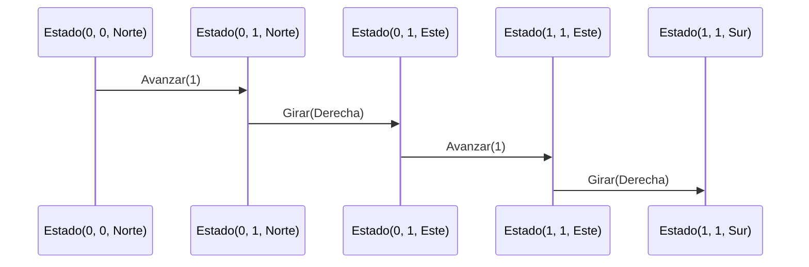

### `aplicarA`

```scala
def aplicarA(estados: List[Estado], o: Orden): List[Estado] =
  estados match {
    case Nil => Nil
    case e :: resto => ejecutar(e, o) :: aplicarA(resto, o)
  }
```

La función recorre la lista de estados con un caso por cada forma de la lista. Si está vacía no hay nada que ejecutar y devuelve la lista vacía. Si no, ejecuta la orden sobre el primer estado y le pega adelante el resultado de seguir con el resto. Cada estado se ejecuta por su cuenta: lo que le pase al robot de un estado no afecta al de otro, y la lista que sale tiene el mismo largo y el mismo orden que la de entrada.

Traza con el modelo de sustitución, usando `aplicarA(List(Estado(0, 0, Norte), Estado(5, 5, Sur)), Avanzar(2))`:

```scala
aplicarA(List(Estado(0,0,Norte), Estado(5,5,Sur)), Avanzar(2))
= ejecutar(Estado(0,0,Norte), Avanzar(2)) :: aplicarA(List(Estado(5,5,Sur)), Avanzar(2))
= Estado(0,2,Norte) :: aplicarA(List(Estado(5,5,Sur)), Avanzar(2))
= Estado(0,2,Norte) :: (ejecutar(Estado(5,5,Sur), Avanzar(2)) :: aplicarA(Nil, Avanzar(2)))
= Estado(0,2,Norte) :: (Estado(5,3,Sur) :: Nil)
= List(Estado(0,2,Norte), Estado(5,3,Sur))
```

La posición de cada robot en cada paso:

| Paso | Estado que se ejecuta | Resultado |
|------|-----------------------|-----------|
| 1 | `Estado(0, 0, Norte)` | `Estado(0, 2, Norte)` |
| 2 | `Estado(5, 5, Sur)` | `Estado(5, 3, Sur)` |

El primer robot mira al norte y sube, así que `y` aumenta de 0 a 2. El segundo mira al sur y baja, así que `y` disminuye de 5 a 3. Es la misma orden, pero cada uno la cumple según hacia dónde mira.

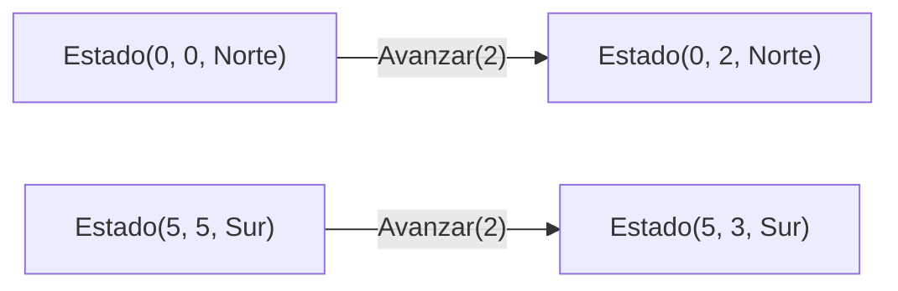

Como `cuantasBasicas` o `profundidad`, `aplicarA` es una recursión lineal: deja un llamado pendiente por cada estado de la lista (la suma de adelante queda esperando), así que la pila crece con el largo de la lista. Para las listas con las que se trabaja en el taller no es un problema.

### `transformar`

```scala
def transformar(o: Orden, f: Orden => Orden): Orden = {
  def transformarTodas(ordenes: List[Orden]): List[Orden] =
    ordenes match {
      case Nil => Nil
      case primera :: resto => transformar(primera, f) :: transformarTodas(resto)
    }

  o match {
    case Avanzar(_) => f(o)
    case Girar(_) => f(o)
    case Repetir(veces, orden) => Repetir(veces, transformar(orden, f))
    case Secuencia(ordenes) => Secuencia(transformarTodas(ordenes))
  }
}
```

Recorre la orden con un caso por cada alternativa del tipo:

* Si la orden es básica (`Avanzar` o `Girar`), le aplica `f` y devuelve lo que `f` dé.
* Si es `Repetir`, deja las veces como estaban y transforma la orden de adentro.
* Si es `Secuencia`, transforma cada orden de la lista, en el mismo orden, con la función auxiliar `transformarTodas` que va por dentro.

`f` solo se aplica a las órdenes básicas, y el resultado de `f` no se vuelve a transformar: si `f` devuelve una orden compuesta, esa se queda tal cual.

Traza con el modelo de sustitución, usando el cuadrado y una `f` que duplica los avances y deja los giros como están:

```scala
transformar(Repetir(4, Secuencia(List(Avanzar(1), Girar(Derecha)))), f)
= Repetir(4, transformar(Secuencia(List(Avanzar(1), Girar(Derecha))), f))
= Repetir(4, Secuencia(transformarTodas(List(Avanzar(1), Girar(Derecha)))))
= Repetir(4, Secuencia(transformar(Avanzar(1), f) :: transformarTodas(List(Girar(Derecha)))))
= Repetir(4, Secuencia(f(Avanzar(1)) :: transformar(Girar(Derecha), f) :: transformarTodas(Nil)))
= Repetir(4, Secuencia(Avanzar(2) :: f(Girar(Derecha)) :: Nil))
= Repetir(4, Secuencia(List(Avanzar(2), Girar(Derecha))))
```

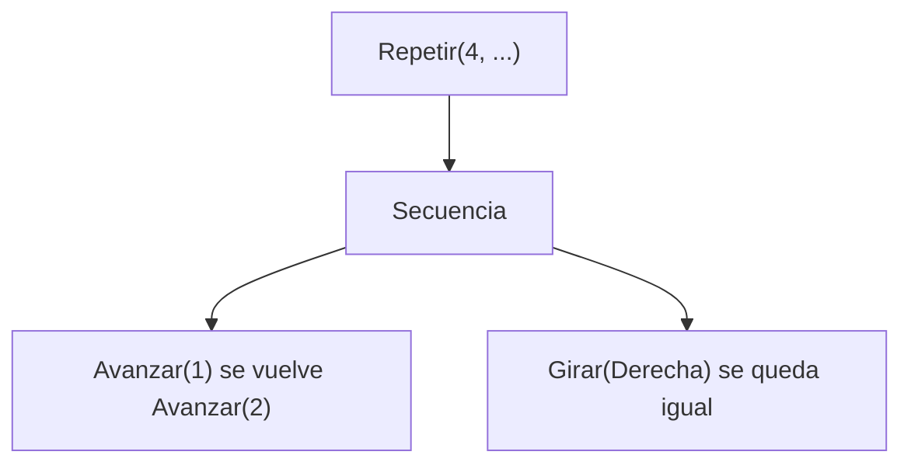

Y la traza de posiciones del robot, ejecutando desde `inicial` la orden original y la transformada. Cada fila es una orden básica que se ejecuta; la de la izquierda es la del cuadrado, y la de la derecha, la misma orden con los avances duplicados:

| Paso | Orden original | Estado original | Orden transformada | Estado transformada |
|------|----------------|-----------------|--------------------|---------------------|
| 0 | (inicio) | `(0, 0, Norte)` | (inicio) | `(0, 0, Norte)` |
| 1 | `Avanzar(1)` | `(0, 1, Norte)` | `Avanzar(2)` | `(0, 2, Norte)` |
| 2 | `Girar(Derecha)` | `(0, 1, Este)` | `Girar(Derecha)` | `(0, 2, Este)` |
| 3 | `Avanzar(1)` | `(1, 1, Este)` | `Avanzar(2)` | `(2, 2, Este)` |
| 4 | `Girar(Derecha)` | `(1, 1, Sur)` | `Girar(Derecha)` | `(2, 2, Sur)` |
| 5 | `Avanzar(1)` | `(1, 0, Sur)` | `Avanzar(2)` | `(2, 0, Sur)` |
| 6 | `Girar(Derecha)` | `(1, 0, Oeste)` | `Girar(Derecha)` | `(2, 0, Oeste)` |
| 7 | `Avanzar(1)` | `(0, 0, Oeste)` | `Avanzar(2)` | `(0, 0, Oeste)` |
| 8 | `Girar(Derecha)` | `(0, 0, Norte)` | `Girar(Derecha)` | `(0, 0, Norte)` |

Los dos recorridos tienen la misma forma: el robot siempre gira en los mismos momentos y vuelve al origen mirando al norte. La diferencia es el tamaño del cuadrado: el original es de lado 1 y el transformado de lado 2, justo lo que se esperaba al duplicar los avances y no tocar los giros.

## Punto 5 Informe de proceso: `simplificar`

Las trazas se escriben como órdenes. Las reglas son las del enunciado:

1. `Avanzar(0)` y `Repetir(0, _)` se vuelven `Secuencia(Nil)`.
2. Dos `Avanzar` seguidos dentro de una secuencia se juntan sumando los pasos.
3. `Repetir(1, o)` se vuelve `o`.
4. Una secuencia de un solo elemento se vuelve ese elemento.
5. Las órdenes que no hacen nada se quitan de las secuencias.

## Cómo funciona

La función tiene tres auxiliares dentro, sin `var`, ciclos ni `return`:

- `juntar(lista)`: recorre la lista y reemplaza dos `Avanzar` seguidos por uno solo con la suma (regla 2).
- `unaPasada(orden)`: aplica las reglas 1, 3, 4 y 5 a toda la estructura, simplificando primero los hijos.
- `hastaQueNoCambie(orden)`: repite `unaPasada` hasta que el resultado sea igual a la entrada. Esto cubre "tantas veces como haga falta".

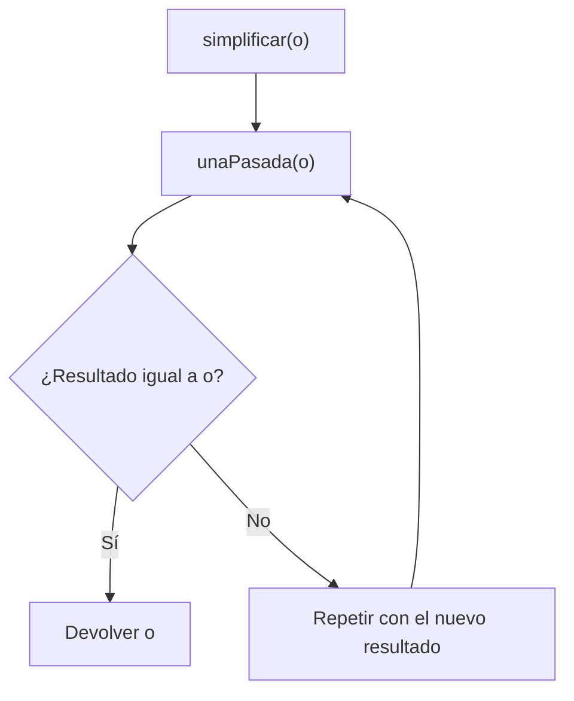

Qué hace `unaPasada` según la orden:

| Orden | Resultado |
|---|---|
| `Avanzar(0)` | `Secuencia(Nil)` (regla 1) |
| `Avanzar(n)`, `Girar(s)` | la misma orden |
| `Repetir(v, _)` con `v <= 0` | `Secuencia(Nil)` (regla 1) |
| `Repetir(1, x)` | `unaPasada(x)` (regla 3) |
| `Repetir(v, x)` | `Repetir(v, y)` con `y = unaPasada(x)`; si `y` es `Secuencia(Nil)` queda `Secuencia(Nil)` |
| `Secuencia(l)` | simplifica los elementos, quita los `Secuencia(Nil)` (regla 5), junta avances (regla 2) y si queda un solo elemento lo devuelve (regla 4) |

Se usa `v <= 0` porque `ejecutar` trata igual a las repeticiones negativas y a las de cero.

## Trazas

**`simplificar(Secuencia(List(Avanzar(2), Avanzar(3))))`**

| Pasada | Orden |
|---|---|
| 1 | Los hijos no cambian. `juntar` produce `List(Avanzar(5))`. Un solo elemento: `Avanzar(5)` |
| 2 | `Avanzar(5)` no cambia, así que termina |

Resultado: `Avanzar(5)`.

**`simplificar(Repetir(1, Avanzar(4)))`**: la regla 3 devuelve `Avanzar(4)` en la primera pasada y la segunda no cambia nada. Resultado: `Avanzar(4)`.

**`simplificar(Secuencia(List(Avanzar(0), Girar(Derecha))))`**

| Pasada | Orden |
|---|---|
| 1 | `Avanzar(0)` se vuelve `Secuencia(Nil)` y se quita. Queda un solo elemento: `Girar(Derecha)` |
| 2 | No cambia, así que termina |

Resultado: `Girar(Derecha)`.

**`simplificar(Secuencia(List(Avanzar(1), Avanzar(2), Girar(Derecha), Avanzar(3))))`**

| Pasada | Orden |
|---|---|
| 1 | `juntar` produce `List(Avanzar(3), Girar(Derecha), Avanzar(3))` |
| 2 | Nada cambia, así que termina |

Resultado: `Secuencia(List(Avanzar(3), Girar(Derecha), Avanzar(3)))`.

**`simplificar(Repetir(0, Avanzar(9)))`**: `v <= 0` entra a la regla 1 y devuelve `Secuencia(Nil)` en una pasada.

**`simplificar(Secuencia(List(Avanzar(2), Avanzar(-2))))`**: aquí hace falta más de una pasada.

| Pasada | Orden |
|---|---|
| 1 | `juntar` produce `List(Avanzar(0))`, y como es un solo elemento queda `Avanzar(0)` |
| 2 | `Avanzar(0)` se vuelve `Secuencia(Nil)` |
| 3 | `Secuencia(Nil)` no cambia, así que termina |

Resultado: `Secuencia(Nil)`.

**`simplificar(Repetir(3, Repetir(1, Avanzar(2))))`**

| Pasada | Orden |
|---|---|
| 1 | El hijo `Repetir(1, Avanzar(2))` se vuelve `Avanzar(2)`. Queda `Repetir(3, Avanzar(2))` |
| 2 | Nada cambia, así que termina |

Resultado: `Repetir(3, Avanzar(2))`.

## Efecto sobre el robot

Simplificar no cambia dónde termina el robot. Por ejemplo, desde `(0, 0, Norte)`:

| Orden | Traza | Estado final |
|---|---|---|
| `Secuencia(List(Avanzar(1), Avanzar(2), Girar(Derecha), Avanzar(3)))` | `(0,1,N)`, `(0,3,N)`, `(0,3,E)`, `(3,3,E)` | `(3, 3, Este)` |
| `Secuencia(List(Avanzar(3), Girar(Derecha), Avanzar(3)))` | `(0,3,N)`, `(0,3,E)`, `(3,3,E)` | `(3, 3, Este)` |

La orden simplificada hace menos pasos y llega al mismo estado.

## Pruebas

Las pruebas de ScalaTest incluyen los ejemplos del enunciado, casos nuevos (negativos, anidamientos, cancelaciones), la idempotencia y que `ejecutar` da el mismo estado antes y después de simplificar. Se ejecutan con `sbt test`.